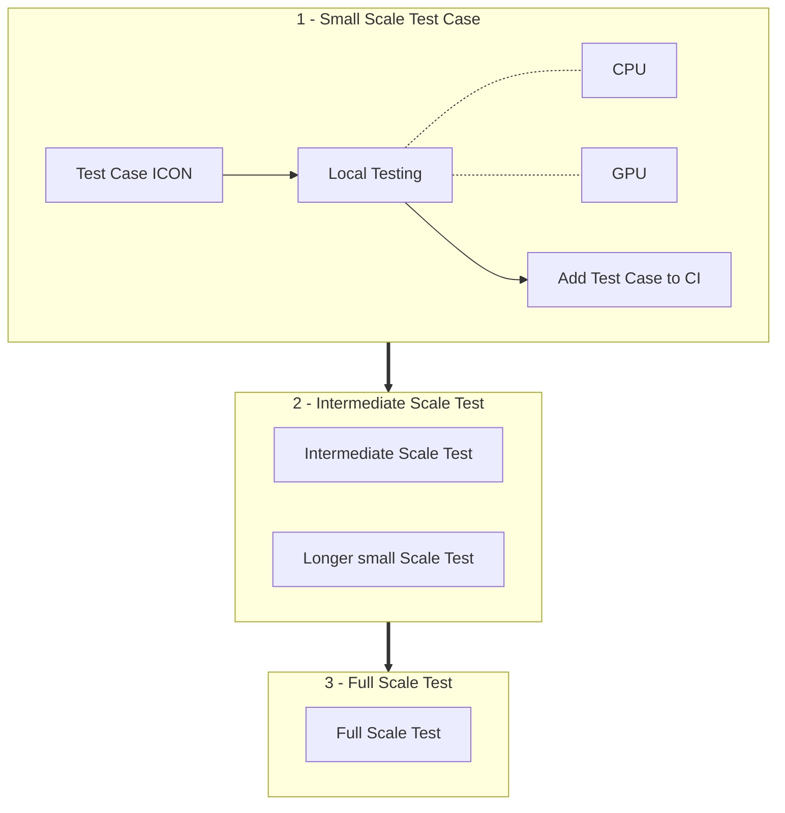

# Validate Custom Namelist

[ICON :material-open-in-new:](https://www.icon-model.org/icon_model){:target="_blank"} is a complex software, and
troubleshooting large configurations can be difficult. To avoid problems, we recommend starting every new namelist
configuration with a small test case. Add this test case to the ICON CI to ensure it stays compatible with future
developments.

You can find a list of available tests in the ICON documentation under
[System
Tests :material-open-in-new:](https://docs.icon-model.org/latest/documentation/infrastructure/testing/system_tests.html#ref-infrastructure-system-tests){:target="_blank"}
within `CI System Tests on External Machines by Builder`.

After the initial test case, we suggest building up step by step: from a small ICON test case to increasingly complex
setups, and finally to your full production configuration. This workflow is described in the ICON documentation under
[Customized Configurations :material-open-in-new:](https://icon.gitlab-pages.dkrz.de/icon-nwp/documentation/buildrun/buildrun_customized.html){:target="_blank"}.
This page complements it with the specific steps for the CSCS machines.

If you are working with a downstream version of ICON, make sure everything runs first in upstream ICON
([ICON :material-open-in-new:](https://gitlab.dkrz.de/icon/icon){:target="_blank"} or
[ICON-NWP :material-open-in-new:](https://gitlab.dkrz.de/icon/icon-nwp){:target="_blank"}). This helps you identify
whether an issue comes from the upstream version or from your downstream modifications.

!!! info "Access upstream ICON"

    If you don't have access to upstream ICON, you need to request it by DKRZ.

## Flow Chart



## 1. Small Scale Test Case

The idea here is to test the code path of the final setup but with only a few time steps to have the test case small
enough for CI.

### 1.1 Set up

#### Compile Out-of-Source

Follow the instructions in [Compile](compile.md) to compile ICON out-of-source for CPU and GPU.

#### Create Test Case and Add It to the Checksuite

Set up an ICON test case with a low number of grid points and a few time steps (about 6). Existing use cases like the
[Aquaplanet :material-open-in-new:](https://gitlab.dkrz.de/icon/icon/-/blob/main/run/exp.exclaim_ape_R02B04){:target="_blank"}
one can serve as a template.

Then follow the step-by-step guide
[Add System Tests to CI :material-open-in-new:](https://icon.gitlab-pages.dkrz.de/icon-nwp/documentation/infrastructure/testing/system_tests.html#ref-infrastructure-system-tests-add-tests){:target="_blank"}
in the ICON-NWP documentation to add the experiment, check script and YAML entries. Start with the `checksuite_modes` for
the base test (`'b'`) on the machine you are testing on.

!!! note "Add test cases to out-of-source build"

    Don't forget to add all your changes also to the out-of-source builds.

### 1.2 Local Testing

Before adding anything to the official ICON, we recommend you to run all tests locally starting with CPU. The general
procedure is described in
[Run ICON Test Cases :material-open-in-new:](https://icon.gitlab-pages.dkrz.de/icon-nwp/documentation/buildrun/buildrun_running.html#ref-buildrun-run-test){:target="_blank"}.
The machine-specific steps for CSCS are given below. First, set up or activate the Python environment:

=== "Santis"

    Follow the
    [Set Up the Probtest Container and Environment on Säntis](probtest.md#2-set-up-the-probtest-container-and-environment-on-santis)
    instructions.

=== "Balfrin"

    ```console
    source /scratch/d1000/apps/buildbot/bb-venv/bin/activate
    module load cdo
    export BB_NAME=balfrin_cpu_nvidia
    ```

#### Test on CPU

To ensure that there are no basic issues with the namelist, we recommend to start testing on CPU before going over to
GPU testing.

Set experiment name, e.g.:

```console
export EXP=c2sm_clm_r13b03_seaice
```

Then, create the check run scripts:

```console
./make_runscripts ${EXP}
./run/make_target_runscript in_script=checksuite.icon-dev/check.${EXP} in_script=exec.iconrun out_script=check.${EXP}.run EXPNAME=${EXP}
```

!!! warning "Compute account"
    Ensure that your default account at CSCS has computing resources. If this is not the case, you need to open a ticket
    at the [CSCS Service Desk :material-open-in-new:](https://support.cscs.ch){:target="_blank"}.

Now run the check run scripts:

=== "Santis"

    ```console
    export UENV_VERSION=$(cat ../config/cscs/SANTIS_ENV_TAG)
    cd run
    uenv run ${UENV_VERSION} --view default -- bash -c 'source ${EDF_PATH}/.venv/bin/activate && ./check.${EXP}.run 2>&1 | tee LOG.check.${EXP}.run.o'
    ```

=== "Balfrin"

    ```console
    cd run && sbatch ---partition debug --time 00:15:00 ./check.${EXP}.run
    ```

Check in the LOG file if all tests passed.

#### Test on GPU

If all tests are validating on CPU, the next step is to test on GPU. Follow the same steps as for CPU and run the
*nproma* and *mpi* tests (see
[ICON Development Checksuite :material-open-in-new:](https://docs.icon-model.org/latest/documentation/infrastructure/testing/system_tests.html#icon-development-checksuite){:target="_blank"}
for a description of all test modes).
Again, check in the LOG file to see if all tests passed before proceeding to the next step.

##### Run Probtest

To ensure that running on GPU gives essentially the same results as running on CPU, you can make use of
[Probtest :material-open-in-new:](https://github.com/MeteoSwiss/probtest?tab=readme-ov-file#probtest){:target="_blank"}.
Therefore, make use of the entries you made to the YML files and initialise Probtest starting with 10 ensemble members
for the CPU reference. Note that you have to set `pinit_seed = 0` and `pinit_amplitude = 0` in the namelist
`initicon_nml` in your test case for running a perturbed ensemble.

=== "Santis"

    Check the instructions in [Run Probtest on Säntis](./probtest.md).

=== "Balfrin"

    ```console
    export BB_NAME=balfrin_cpu_nvidia
    file_id=$("scripts/experiments/get_probtest_file_id" --experiment ${EXP})
    python externals/probtest/probtest.py init --codebase-install $PWD --experiment-name ${EXP} --reference $PWD $file_id --member-ids $(seq -s, 1 10)
    ```

    Then follow the Probtest instructions [Example: Check the output of an ICON experiment with a test build compared to a reference build :material-open-in-new:](https://github.com/MeteoSwiss/probtest?tab=readme-ov-file#example-check-the-output-of-an-icon-experiment-with-a-test-build-compared-to-a-reference-build){:target="_blank"} skipping the *Initialize probtest* step.

If Probtest validates, prepare the test for the CI as described in
[Test on GPU :material-open-in-new:](https://icon.gitlab-pages.dkrz.de/icon-nwp/documentation/buildrun/buildrun_customized.html#test-on-gpu){:target="_blank"}
in the ICON documentation.

### 1.3 Activate Test in a CI Pipeline

Push your changes to a branch on ICON and open a merge request. To select the ensemble members and to generate the
references and tolerances with CSCS-CI, follow
[Generate References and Tolerances :material-open-in-new:](https://icon.gitlab-pages.dkrz.de/icon-nwp/documentation/infrastructure/testing/cscs_ci.html#ref-infrastructure-cscs-ci-tol){:target="_blank"}
in the ICON documentation.

## 2. Intermediate and Full Scale Tests

For the next steps towards your production configuration, follow
[Intermediate Scale Test :material-open-in-new:](https://icon.gitlab-pages.dkrz.de/icon-nwp/documentation/buildrun/buildrun_customized.html#intermediate-scale-test){:target="_blank"}
and
[Full Scale Test :material-open-in-new:](https://icon.gitlab-pages.dkrz.de/icon-nwp/documentation/buildrun/buildrun_customized.html#full-scale-test){:target="_blank"}
in the ICON documentation.
